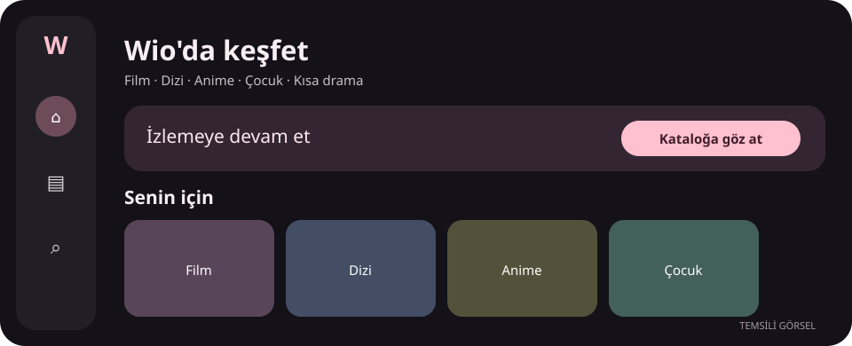
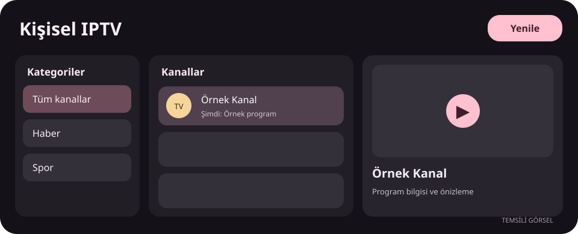
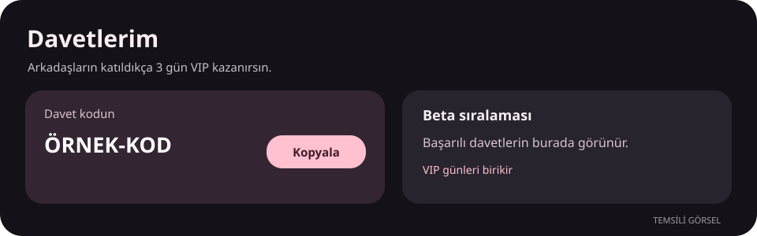

# Wio

Wio; kişisel IPTV listelerini, içerik keşfini ve oynatmayı telefon ile Android TV'de bir araya getiren ücretsiz bir beta uygulamasıdır. Arayüz Türkçedir. IPTV için kendi M3U veya Xtream bağlantınızı eklersiniz; katalogdaki bir yapımın oynatılması, o yapım için erişilebilir bir kaynağa bağlıdır.

> **Beta sürümü:** Kumanda odağı, bazı kaynaklar ve dikey Shorts yönü üzerinde çalışıyoruz. Özellikle bazı cihazlarda Shorts yataya dönebilir. Hata bildirirken cihaz modelini, Wio sürümünü ve mümkünse Ayarlar → Log gönder çıktısını paylaşın. IPTV adresinizi veya parolanızı herkese açık mesajlara koymayın.

## Neler var?

- **Kişisel IPTV:** M3U ve Xtream listeleriyle canlı TV, film ve diziler. Kategori ve kanal listesi cihazda saklanır; **Yenile** ile isteğiniz üzerine tekrar alınır.
- **Katalog ve keşif:** Film, dizi, anime, çocuk ve kısa drama alanları; posterler, detaylar ve kaynağa göre oynatma.
- **İzlemeye devam et:** Profil bazlı geçmiş ve kaydedilenler. İndirilen içerikler bağlantı yokken de açılabilir.
- **Telefon ve TV:** Dokunma ile kumanda kullanımına uygun ayrı yerleşimler, görünür odak ve uygulama içinden ayarlanabilen tema rengi.
- **Kaynak seçimi:** Bulunan kaynaklar arasında geçiş ve oynatıcıda ses/altyazı tercihleri. Bir yapım için kaynak bulunması garanti değildir; hata ekranındaki geri bildirim yolunu kullanabilirsiniz.

## Beta davetleri ve VIP

Hesap açarken davet kodu ilk kayıt sırasında girilir. Başarılı davet, davet eden hesaba **3 gün VIP** hakkı kazandırır; günler birikir. Beta kampanyasında davet kullanım sınırı kaldırılmıştır. Davet sayfasında kişisel kodunuzu ve sıralamanızı görebilirsiniz. Yarışma ödülleri ve dönem bilgileri uygulamadaki davet ekranında gösterilir.

VIP şu anda geliştirme aşamasındadır. Mevcut farklardan biri oynatıcı filigranının kaldırılmasıdır; yeni ayrıcalıklar duyuruldukça açıklanacaktır. Destek seçenekleri gönüllüdür.

## İndir ve geri bildirim gönder

[Doğrudan en güncel APK'yı indir](https://github.com/Wiojelt/Wio-Releases/releases/latest/download/WioTV-latest.apk) · [Sürüm notları ve SHA-256 dosyaları](https://github.com/Wiojelt/Wio-Releases/releases/latest)

Kurulum için APK'yı indirin. SHA-256 dosyası, indirdiğiniz dosyanın bütünlüğünü kontrol etmenize yarar. Güncellemeler uygulamanın içinden duyurulur. Android TV/box kumandasında çalışmayan bir yol bulursanız hangi ekranda hangi yön tuşuna bastığınızı da yazın.

Bu sayfadaki çizimler **temsili** ekranlardır; yayın görüntüsü, gerçek kullanıcı hesabı, özel IPTV adresi veya telifli kanal logosu içermez.

Foruma kopyalanabilecek kısa tanıtım

**Wio beta — telefon ve Android TV için Türkçe medya uygulaması**

Kendi M3U/Xtream listenizle kişisel IPTV izleyebilir; film, dizi, anime, çocuk ve kısa drama kataloglarında içerik keşfedebilirsiniz. Profil bazlı geçmiş, indirilenler, tema rengi ve oynatıcı tercihleri bulunur. İçeriğin açılması kullanılabilir kaynağa bağlıdır.

Beta sürecinde kumanda gezinmesi ve kaynak uyumluluğu geliştiriliyor. Başarılı her davet 3 gün VIP kazandırır; beta kampanyasında davet sınırı kaldırılmıştır. Bilinen sorun: Shorts bazı dikey cihazlarda yataya dönebilir.

İndirme: https://github.com/Wiojelt/Wio-Releases/releases/latest/download/WioTV-latest.apk

Hata bildirimi: Cihaz modeli + Wio sürümü + izlediğiniz yol; mümkünse uygulamadaki “Log gönder” çıktısı. IPTV kullanıcı adı ve parolasını paylaşmayın.

## Geliştirme gündemi

Kaynak doğrulaması ve kalite bilgisi, daha hızlı kaynak seçimi, TV kumandasıyla gezinme, profil/davet düzenlemeleri ve kişisel IPTV deneyimi üzerinde çalışılıyor. Geliştirme dalındaki özellikler doğrulanmadan bu sayfada yayımlanmış özellik olarak gösterilmez.
